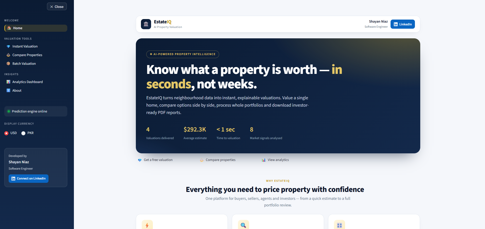
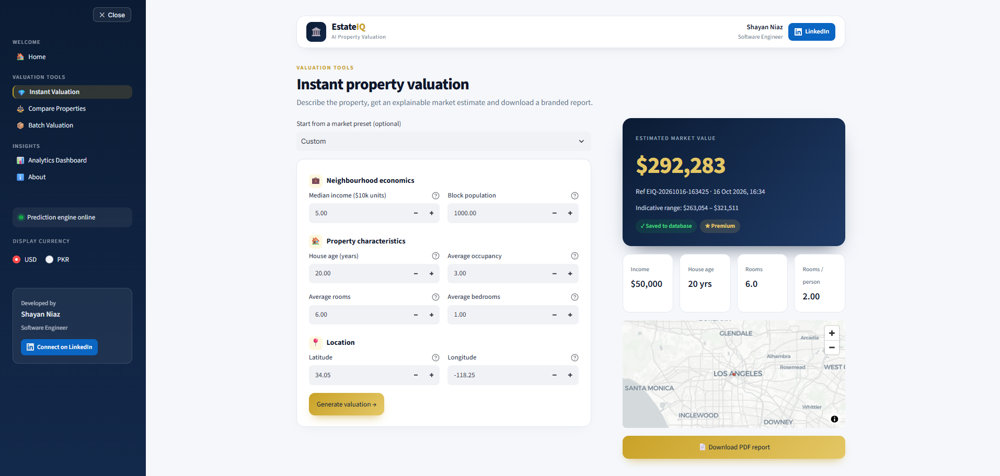
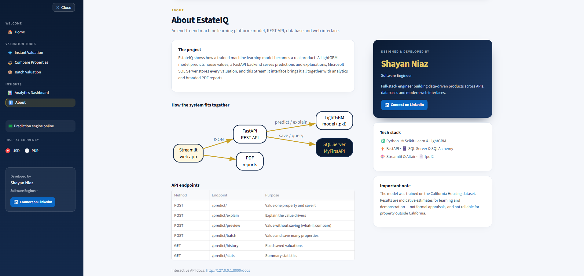
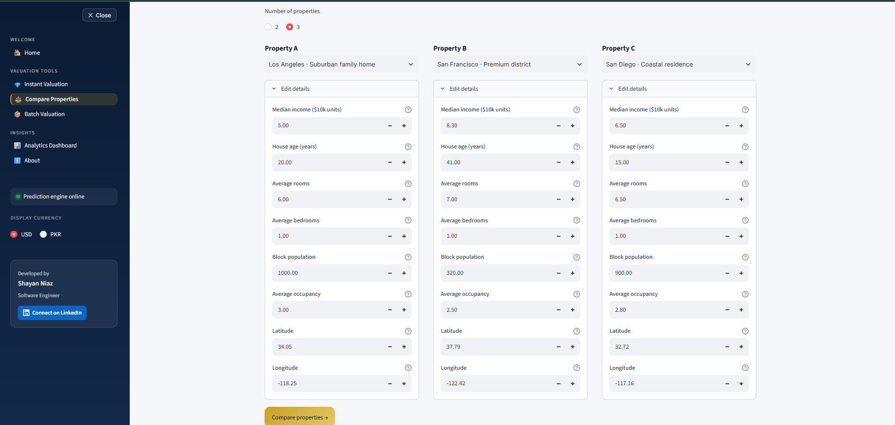
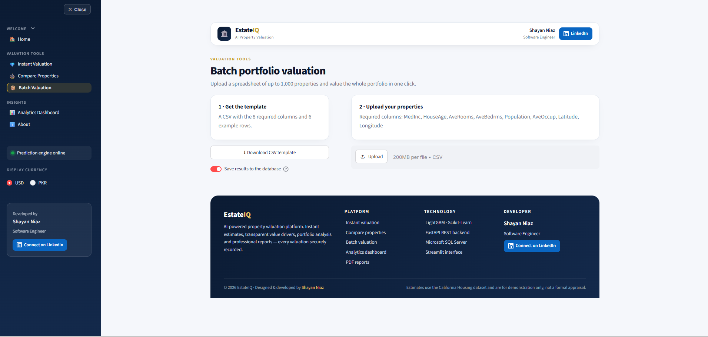
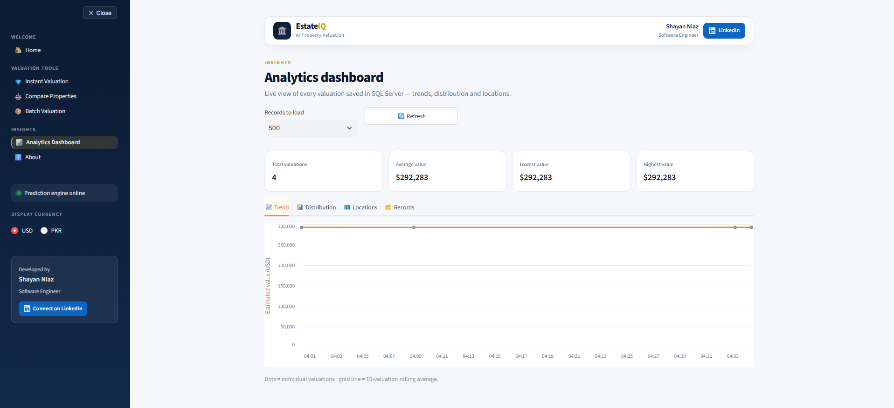
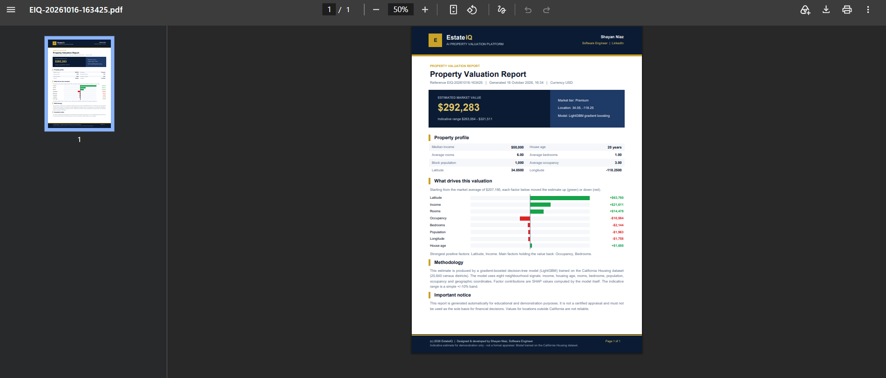

# House Price Prediction – Step-by-Step Setup (Windows)

All the code is already written. You only need to install things, change ONE line, and run commands.
Do the steps in order. After each command, check that you see the "You should see" message.

---

## PART A – Install the software (one time only)

1. **Python 3.12** – download from https://www.python.org/downloads/
   During install, TICK the box **"Add Python to PATH"**.
2. **SQL Server Express** (free) – https://www.microsoft.com/sql-server/sql-server-downloads → "Express" → Basic install.
3. **SSMS** (SQL Server Management Studio) – https://aka.ms/ssmsfullsetup
4. **ODBC Driver 17 for SQL Server** – search "ODBC Driver 17 for SQL Server download" on Microsoft's site and install it.

---

## PART B – Open the project in a terminal

1. Unzip `house-price-prediction-api.zip`, e.g. into `E:\projects\`.
2. Open the folder `house-price-prediction-api` in File Explorer.
3. Click the address bar at the top, type `cmd`, press Enter. A black window (terminal) opens **in this folder**.
   > Every command below is typed into this window.

---

## PART C – Install the Python libraries

```
python -m venv venv
venv\Scripts\activate
pip install -r requirements.txt
```
You should see `(venv)` at the start of the line. The install takes a few minutes.

> Each time you open a NEW terminal later, run `venv\Scripts\activate` first.

---

## PART D – Create the trained model (the .pkl file)

```
python train_model.py
```
You should see: `Model saved to: ...house_price_model.pkl`

---

## PART E – Connect to SQL Server

1. Open **SSMS**. The "Server name" box in the connect window shows your server name
   (e.g. `(localdb)\MSSQLLocalDB`, `localhost\SQLEXPRESS` or `DESKTOP-XXXX\SQLEXPRESS`). Copy it.
   > This project is already set to `(localdb)\MSSQLLocalDB`. If that's your server, skip step 2.
2. Open `app\database\connection.py` in Notepad and change this line to your server name:
   ```
   SERVER = r"localhost\SQLEXPRESS"
   ```
   Save the file.
3. Run these, one at a time:

| Command | You should see |
|---|---|
| `python -m app.database.list_drivers` | `ODBC Driver 17 for SQL Server` in the list |
| `python -m app.database.connection` | `Connected to SQL Server successfully!` |
| `python -m app.database.create_database` | `Database 'MyFirstAPI' created successfully!` (or "already exists") |
| `python -m app.database.create_table` | `Tables created successfully in 'MyFirstAPI'!` |

---

## PART F – Test the pieces

| Command | You should see |
|---|---|
| `python -m app.schemas.house` | `Schema created successfully!` |
| `python -m app.services.prediction_service` | `Record saved successfully. ID: 1` and a price |

---

## PART G – Run the whole app (needs TWO terminals)

> ⚠️ **Do Part E first!** If you skip `create_database` and `create_table`, clicking Predict gives the error
> `Cannot open database "MyFirstAPI" requested by the login`. See the "If something goes wrong" table below.

**Terminal 1 (the API)** – in the project folder:
```
venv\Scripts\activate
python -m uvicorn app.main:app --reload
```
Leave it open. Visit http://127.0.0.1:8000/docs to see the API page.

**Terminal 2 (the website)** – open a second terminal in the same folder:
```
venv\Scripts\activate
python -m streamlit run frontend/app.py
```
Your browser opens http://localhost:8501. Click **Predict House Price**.

---

## PART H – Check the saved data

In SSMS, click **New Query**, paste this, press **F5**:
```sql
SELECT TOP 20 * FROM MyFirstAPI.dbo.HousePredictions ORDER BY id DESC;
```
You'll see every prediction you made. **Task complete!** Take screenshots of the Streamlit page and this table as proof.

---

## PART I – Explore the platform (EstateIQ features)

Use the **sidebar** (click **☰ Menu** if it's closed) to move between pages:

| Page | What it does |
|---|---|
| 🏠 **Home** | Welcome page: what the platform does, live stats, FAQ. |
| 💎 **Instant Valuation** | Value one property. Shows the price, a map, **"Why this price?"** (which factors raised or lowered it) and a **What-if simulator**. Click **Download PDF report** for a branded report. |
| ⚖️ **Compare Properties** | Value 2–3 properties side by side, see the best one, download a comparison PDF. |
| 📦 **Batch Valuation** | Download the CSV template, fill in many properties, upload it, value them all at once. Download results as CSV or a portfolio PDF. |
| 📊 **Analytics Dashboard** | Charts, map and table of every valuation saved in SQL Server. Export to CSV. |
| ℹ️ **About** | How the system works, the API endpoints, and the developer. |

**Currency:** in the sidebar, switch between **USD** and **PKR**. For PKR, type today's exchange rate yourself.

**Note:** single and batch valuations are saved to the database. What-if simulations and comparisons are not saved.

---

## Updating from the older version

If you already had the first version running:
1. Replace the whole project folder with the new one, but **keep your `venv` folder and `app\models\house_price_model.pkl`** (or just run `python train_model.py` again).
2. Install the new libraries: `pip install -r requirements.txt`
3. Restart **both** terminals (Ctrl+C, then start them again as in Part G).

Your database and table stay the same — nothing to change in SQL Server.

---

## If something goes wrong

| Error message | Fix |
|---|---|
| `'python' is not recognized` | Reinstall Python and tick "Add Python to PATH". |
| `Login failed` / `server was not found` | The SERVER name in `connection.py` is wrong – copy it exactly from SSMS. Check SQL Server is running (search "Services" in Windows → "SQL Server (SQLEXPRESS)" → Start). |
| `Data source name not found` / driver error | Install ODBC Driver 17. If you have Driver 18 instead, change `DRIVER` in `connection.py` to `"ODBC Driver 18 for SQL Server"`. |
| `Cannot open database "MyFirstAPI" requested by the login` (or `Login failed ... (18456)` with `(4060)`) when clicking Predict | The database/table was never created. 1) Press **Ctrl+C** in the uvicorn terminal to stop it. 2) Run `python -m app.database.create_database` → should say `Database 'MyFirstAPI' created successfully!` 3) Run `python -m app.database.create_table` → should say `Tables created successfully in 'MyFirstAPI'!` 4) Restart: `python -m uvicorn app.main:app --reload` and click Predict again. |
| `No such file ... house_price_model.pkl` | You skipped Part D. Run `python train_model.py`. |
| `No module named ...` | Run `venv\Scripts\activate` then `pip install -r requirements.txt`. |
| Streamlit says "Cannot reach the prediction engine" / sidebar shows **offline** | Terminal 1 isn't running. Start it (Part G). |
| `No module named 'fpdf'` or `'altair'` | Run `pip install -r requirements.txt` (new libraries were added). |
| `404 Not Found` on Explain / Dashboard / Batch | The old backend is still running. Stop Terminal 1 (Ctrl+C) and start it again. |
| `TypeError ... width` or `st.navigation` error | Your Streamlit is too old. Run `pip install -U streamlit`. |

**Note:** the model is trained on California housing data, so prices are for demonstration only, not real Pakistani property values.


## 📸 Screenshots

### Home


### Instant Valuation


| Why this price? | What-if simulator |
|---|---|
|  |  |

### Compare Properties


### Batch Valuation


### Analytics Dashboard


| PDF Report | Saved in SQL Server |
|---|---|
|  |  |